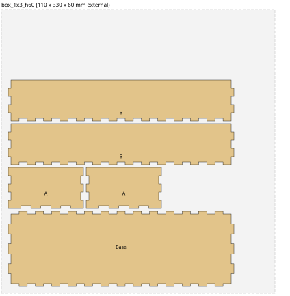

# Drawer divider boxes

A modular set of open-top, finger-jointed boxes that tile a kitchen drawer. The drawer is
880 x 440 mm, so the boxes sit on a 110 mm grid (8 x 4 units). Boxes come in two heights,
60 mm standard and 120 mm double-height, and are cut from 4 mm sheet. All dimensions are
**external**, so boxes butt up against each other and the drawer sides without gaps.

| Footprint (mm) | Standard, 60 mm tall | Sheets | Double, 120 mm tall  | Sheets |
|----------------|----------------------|--------|----------------------|--------|
| 110 x 110      | `box_1x1_h60.lbrn2`  | 1      | `box_1x1_h120.lbrn2` | 1      |
| 110 x 220      | `box_1x2_h60.lbrn2`  | 1      | `box_1x2_h120.lbrn2` | 2      |
| 110 x 330      | `box_1x3_h60.lbrn2`  | 1      | `box_1x3_h120.lbrn2` | 2      |
| 220 x 330      | `box_2x3_h60.lbrn2`  | 2      | `box_2x3_h120.lbrn2` | 2      |
| 330 x 330      | `box_3x3_h60.lbrn2`  | 2      | `box_3x3_h120.lbrn2` | 3      |

Sheet counts are for a Creality Falcon 2 bed of 400 x 415 mm.

Each file holds five parts: one base, two "Side A" panels and two "Side B" panels.
Side A has tabs at its top corners and Side B has notches there, so the two types alternate
around the box. The base has its corners relieved and joins all four sides with fingers.
The `preview/` folder has an SVG picture of every layout.



## Cutting

- Parts are kept 10 mm inside the bed edges. Layers are named `Sheet 1`, `Sheet 2` and so on.
  Parts for sheets after the first are parked to the right of the bed: drag each sheet's parts
  onto the bed for its run, or disable the layers you are not cutting.
- Layer defaults are 8 mm/s, 100 % power, 1 pass, 0.1 mm kerf offset. These are a starting
  point for a 22 W Falcon 2 on 4 mm ply, not tested values. Cut a small test piece first and
  adjust speed, passes and kerf. Too little kerf offset gives loose fingers; too much and the
  joints will not go together.
- Eight 1x1 boxes across the drawer add up to exactly 880 mm. If your drawer is a tight
  880 mm internally, reduce the unit size slightly or plan on leaving one gap.

## Regenerating or changing the design

`generate_boxes.cs` is a single-file C# script. It needs the .NET 10 SDK or later and no
other dependencies. The constants at the top set material thickness, the list of heights,
grid unit, target finger width, part spacing, bed size and the laser layer defaults. Edit
them and run, from this folder:

```bash
dotnet run generate_boxes.cs
```

It rewrites every `.lbrn2` file and the SVG previews. To add a footprint, add a pair to the
`designs` list; to add a height, add it to `heights`.

How it works, briefly: each panel starts as a full-size rectangle and has rectangular notches
removed along its edges wherever a neighbouring panel owns that bit of the joint. The script
then traces the outline of what remains and packs the panels onto sheets, starting a new
sheet when the parts will not fit.

## LightBurn file format notes

The `.lbrn2` writer targets LightBurn 2.x and was checked by opening the files in LightBurn
2.1. Two things that were not obvious:

- Each `Shape` needs `VertID` and `PrimID` attributes, and they must be unique per shape.
  Without them LightBurn drops the shape silently; with duplicates it merges the vertex lists
  and you get stray diagonal cuts.
- Vertices go in a single `VertList` string (`Vx yc0x1c1x1` per vertex) with a `PrimList` of
  `LineClosed` for a closed polyline.
