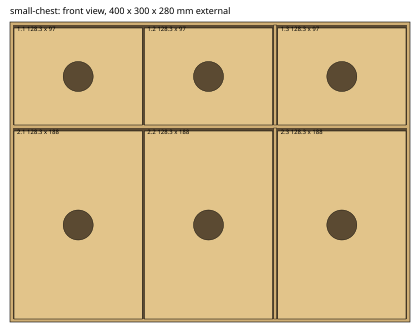

# Drawer cabinet

Generates a cabinet of finger-jointed drawers as LightBurn files for a Creality Falcon 2.
You describe the cabinet in a small JSON file: its size, the height of each row and the
smallest drawer you want. The generator works out the rest and writes one LightBurn file
per sheet of wood.

```bash
dotnet run generate_cabinet.cs -- examples/small-chest.json
```

It needs the .NET 10 SDK or later and nothing else. Output goes to a folder named after the
config file, next to it. Pass a second argument to choose another folder.



## How the cabinet is built

- **Carcass.** A five-sided box open at the front: left, right, top, bottom and back,
  joined with finger joints. All sizes are external.
- **Rows.** Rows are stacked top to bottom as listed in the config. Between rows sits a
  shelf. Shelves hold on with tabs that pass through slots in the sides and back.
- **Drawers.** Each drawer is an open-top finger-jointed box that rests on the shelf below
  it. The front has a round finger hole in the centre.
- **Widths.** The drawers in a row use the row's whole internal width. The generator fits as
  many drawers as it can at your minimum width, then widens them all equally.
- **Vertical supports.** When a stretch of shelf would be wider than `supports.maxSpan`, a
  vertical divider is added between two drawers. The drawers get slightly narrower to make
  room for it. Dividers tab into the shelf above and below and into the back.
- **Big panels.** Any panel larger than one sheet is cut into pieces that lock together with
  T-shaped tabs, like a jigsaw. Glue them. Seams are placed to avoid joints and slots.

## Output

One `.lbrn2` file per sheet of wood, so each file is one run of the laser:

| File | Contents |
|------|----------|
| `<name>-carcass-N.lbrn2` | Carcass, shelves and dividers (default) |
| `<name>-drawers-N.lbrn2` | Every drawer part (default) |
| `<name>-sheet-N.lbrn2` | All parts together, when `output.mixParts` is `true` |
| `<name>-summary.md` | Row and drawer sizes, and a table of every part with its size and file |
| `<name>-front.svg` | Front view of the finished cabinet |
| `preview/<file>.svg` | Picture of each sheet, with part labels |

Each file has one layer, `Cut`. The notes that appear when a file loads list the parts on
that sheet and where to put the wood: place the stock with its corner at X 10, Y 10 (the bed
margin). Parts stay 5 mm inside the stock edge.

Part labels in the previews and summary: `D2.1 Front` is the front of drawer 1 in row 2,
counting rows from the top and drawers from the left. A label like `Back 1/2` is one piece
of a split panel.

## Config format

A standard JSON file. Names are not case sensitive. The reader also tolerates comments and trailing commas, but they are not valid JSON, so the examples avoid them.
A misspelt name is reported as an error, not ignored. All lengths are millimetres.

```json
{
  "name": "small-chest",
  "stock": { "width": 300, "length": 400 },
  "cabinet": { "width": 400, "height": 300, "depth": 280 },
  "rows": [
    { "height": 100 },
    { "height": "auto" }
  ],
  "drawers": { "minWidth": 120, "fingerHoleRadius": 15 }
}
```

Only `cabinet`, `rows` and `drawers` are required. Everything else has a default.

### `name`

Text, default `cabinet`. Used as the file name prefix.

### `material`

| Key | Default | Meaning |
|-----|---------|---------|
| `thickness` | 3 | Sheet thickness, 1 to 12. Joints, slots and tabs all follow it. |

### `stock`

The wood you cut from. Use 300 x 400 or 300 x 600, or any other size.

| Key | Default | Meaning |
|-----|---------|---------|
| `width` | 300 | Short side of the sheet |
| `length` | 400 | Long side of the sheet |
| `edgeMargin` | 5 | Parts stay this far inside the sheet edge |

### `machine`

| Key | Default | Meaning |
|-----|---------|---------|
| `bedWidth` | 400 | Laser work area, X |
| `bedHeight` | 415 | Laser work area, Y |
| `bedMargin` | 10 | Keep the sheet this far from the bed edge |
| `partGap` | 4 | Space between parts |

The cutting area on each sheet is the smaller of what the wood and the bed allow:

```
width  = min(stock.width  - 2 x edgeMargin, bedWidth  - 2 x bedMargin - edgeMargin)
height = min(stock.length - 2 x edgeMargin, bedHeight - 2 x bedMargin - edgeMargin)
```

Panels bigger than this are split. Parts may be rotated to fit.

> **600 mm stock on a Falcon 2.** The bed is only 415 mm deep, so a 300 x 600 sheet cannot
> be cut in one go. With the default machine settings the cutting area comes out the same
> as for 300 x 400 stock (290 x 390 mm). The longer sheet only helps if your machine can
> reach it: raise `machine.bedHeight` for a larger bed or a pass-through.

### `laser`

Settings written to the `Cut` layer. These are untested starting values for 3 mm ply.
Cut a scrap test and adjust before the real job.

| Key | Default | Meaning |
|-----|---------|---------|
| `speed` | 8 | mm/s |
| `power` | 100 | Percent |
| `passes` | 1 | Number of passes |
| `kerf` | 0.1 | Kerf offset in mm. Too small gives loose joints, too large stops them fitting. |

### `cabinet` (required)

External size of the finished cabinet.

| Key | Meaning |
|-----|---------|
| `width` | Left to right |
| `height` | Bottom to top |
| `depth` | Front to back, including the back panel |

### `rows` (required)

A list, **top row first**. Each row is an object:

| Key | Default | Meaning |
|-----|---------|---------|
| `height` | required | Clear opening of the row in mm, or `"auto"` |
| `minWidth` | `drawers.minWidth` | Smallest drawer width for this row |
| `count` | worked out | Force this many drawers instead |

The rows must fill the cabinet exactly:

```
cabinet.height = 2 x thickness + sum of row heights + (rows - 1) x thickness
```

That is the top and bottom panels, the rows, and one shelf between each pair of rows. If you
make one row `"auto"`, it takes whatever height is left. Only one row may be `auto`. If the
heights do not add up, the error tells you the cabinet height that would work.

A row's drawers are a little shorter than its opening (see `clearanceY`). A row must be at
least 30 mm high.

### `drawers` (required)

| Key | Default | Meaning |
|-----|---------|---------|
| `minWidth` | required | Smallest allowed width per drawer, including its gap. Drawers are widened from this. |
| `fingerHoleRadius` | required | Radius of the round hole in the centre of each front |
| `clearanceX` | 2 | Total side-to-side play per drawer |
| `clearanceY` | 3 | Gap above each drawer |
| `clearanceZ` | 3 | Gap behind each drawer |

The finger hole must fit the smallest front with 4 mm to spare beyond the joints. If it does
not, the error gives the largest radius that will.

### `supports`

| Key | Default | Meaning |
|-----|---------|---------|
| `maxSpan` | 350 | Widest unsupported stretch of shelf. Wider rows get vertical dividers. Use `null` for no dividers. |

3 mm ply sags if a shelf is wide and heavily loaded. Lower this for heavy contents.

### `output`

| Key | Default | Meaning |
|-----|---------|---------|
| `mixParts` | `false` | `false` puts carcass parts and drawer parts on separate sheets. `true` packs them together to waste less wood. |

Mixing fills the strips left beside big panels with small drawer parts. It saved 3 sheets
on the parts cabinet below (14 down to 11). The files are then named `<name>-sheet-N.lbrn2`
and no longer split into carcass and drawers. The summary file lists the sheet for every part.

### `joints`

Rarely needed.

| Key | Default | Meaning |
|-----|---------|---------|
| `fingerWidth` | 12 | Target width of corner finger joints |
| `tabWidth` | 20 | Target width of shelf and divider tabs |
| `margin` | 6 | Keep slots this far from edges and from each other |
| `split.tabPitch` | 70 | Spacing of the locking tabs where panels are split |
| `split.neckWidth` | 6 | Narrow part of a locking tab |
| `split.headWidth` | 12 | Wide part of a locking tab |
| `split.neckDepth` | 3 | Length of the narrow part |
| `split.headDepth` | 4 | Length of the wide part |

## Examples

- [`examples/small-chest.json`](examples/small-chest.json): 400 x 300 x 280 mm, two rows of
  three drawers, one divider per row. The generated files are in
  [`examples/small-chest/`](examples/small-chest/): 21 sheets.
- [`examples/kitchen-cabinet.json`](examples/kitchen-cabinet.json): 600 x 480 x 350 mm with
  16 drawers. Config only. It needs 56 sheets of 300 x 400 ply, so check the maths on a
  smaller cabinet before generating this one.

## How many sheets

Plywood use grows quickly. A 300 x 400 sheet is only 0.12 m2, and every panel and drawer is
cut from it. Deep drawers cost the most: each drawer side is as long as the cabinet is deep.
Many panels also leave an unusable strip, because a 280 mm panel nearly fills the 290 mm
cutting width. Check the sheet count the generator prints before you buy wood. Fewer, bigger
drawers use less wood than many small ones. Turning on `output.mixParts` usually saves a few more sheets.

## Checks the generator makes

Before writing any file it assembles the cabinet in memory and checks that no two panels
occupy the same space, and that the total volume of wood equals what the finished cabinet
should contain. Together these mean every tab fills its slot and every finger meets its
notch. A clash stops the run with a message naming the two panels. The same check runs for
each distinct drawer size.

It does not check strength, how snug the joints are on your laser, or whether a drawer
slides well. It does not model the locking tabs on split panels either, which are laid out
so that both sides of a seam share one outline. Cut a small test cabinet first.

Two generated sheets of the small chest were opened in LightBurn 2.1 and both loaded with
every part. On one of them the preview cut distance (2020 mm) matched the computed length
(2022 mm).

## Limits

- Drawers slide on the shelf below, with no runners.
- Drawers must be at least 40 mm wide, 25 mm high and 40 mm deep.
- Each drawer and divider is cut as a separate part. There is no engraved part numbering, so
  keep the preview pictures to hand when assembling.

## Another example

[`examples/parts-cabinet.json`](examples/parts-cabinet.json): 330 x 200 x 200 mm with three
equal rows of 6, 3 and 2 drawers, and a 3.2 mm hole (radius 1.6) in each front for an M3 bolt
handle. The last row is `"auto"` so that the three equal heights add up exactly. Generated
files are in [`examples/parts-cabinet/`](examples/parts-cabinet/): 11 sheets, with `output.mixParts` on (14 without).

[`examples/parts-cabinet-180.json`](examples/parts-cabinet-180.json) is the same cabinet at
180 mm high, with three rows of 56 mm. It needs 10 sheets against 11 at 200 mm. Generated
files are in [`examples/parts-cabinet-180/`](examples/parts-cabinet-180/).
